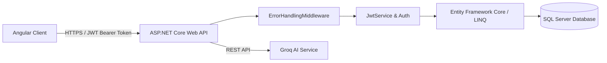

# TripFlow – Travel Flow Assistant


## Overview
**TripFlow** is a full-stack travel and hotel booking assistant built with **ASP.NET Core Web API**, **Angular**, and **Microsoft SQL Server**, integrating AI-powered recommendations via the **Groq API**. Beyond core functional features, the application was engineered with a **Security-by-Design** mindset to mitigate common web vulnerabilities aligned with the **OWASP Top 10**.

## System Architecture



## Security Controls & Hardening
* **Authentication & Authorization:** Stateless session management using **JSON Web Tokens (JWT)** with strict issuer, audience, and expiration validation (`JwtService.cs`).
* **Credential Protection:** Passwords hashed and salted using **BCrypt** prior to persistence, eliminating plaintext storage risks.
* **SQL Injection Prevention:** Enforced parameterized queries across all data access operations via **Entity Framework Core** and **LINQ**.
* **Secure Error Handling:** Centralized exception handling (`ErrorHandlingMiddleware.cs`) to sanitize API responses and prevent stack trace or internal information disclosure.
* **Secrets Management:** Sensitive API keys and connection credentials decoupled from source control (`appsettings.json` sanitized).

## Repository Structure
```text
├── Travel_Flow/                  # ASP.NET Core Web API Backend (Services, Data, Middleware, Migrations)
├── trip-flow-client/             # Angular & TypeScript Frontend Application
└── README.md
```

## Tech Stack
* **Backend:** C#, ASP.NET Core Web API, Entity Framework Core, LINQ, xUnit
* **Frontend:** Angular, TypeScript, HTML5, CSS3
* **Database:** Microsoft SQL Server
* **AI Integration:** Groq API

**Author:** Omar Said Taha Bashir
